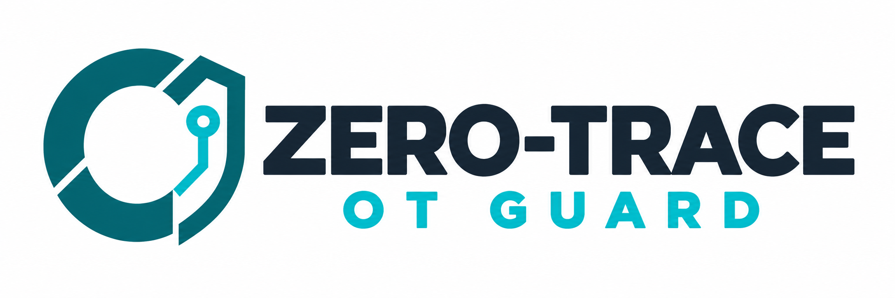

# Zero-Trace OT Guard branding

Use **Zero-Trace OT Guard** as the product name. Keep the existing command `otguard` and distribution name `zero-trace-ot-guard` unchanged.

## Assets

- [Wordmark on white](../src/otguard/assets/zero-trace-logo.png): README, documentation, release pages and presentations. The white background preserves contrast in light and dark interfaces.
- [Transparent wordmark](../src/otguard/assets/zero-trace-logo-transparent.png): use on a light, uncluttered background.
- [Square avatar](../src/otguard/assets/zero-trace-avatar.png): GitHub profile image and other small profile placements. The emblem works without the wordmark at avatar size.

Downloadable PNGs are attached to the rc.5 release. These are raster assets, not vector artwork. Keep their proportions and sufficient surrounding space; do not stretch or use the logo as an OT safety certification badge.

## GitHub profile image

Profile-photo upload requires the account owner's GitHub settings interface; repository Git pushes cannot set it. For the zero-trace-usa personal account, open [GitHub profile settings](https://github.com/settings/profile), edit the profile picture and upload `zero-trace-avatar.png`. For an organization, use that organization's profile settings with an authorized owner account.

The repository README displays the full wordmark. GitHub repository social-preview images use a separate settings upload; the wordmark can be used there, but that upload has not been performed by this project workflow.

## Offline reports

The wheel and source package include the images. Generated report.html embeds its wordmark and favicon as PNG data URLs; copying the report to another machine preserves the branding without Internet access. No external fonts, image fetches or telemetry are added.
